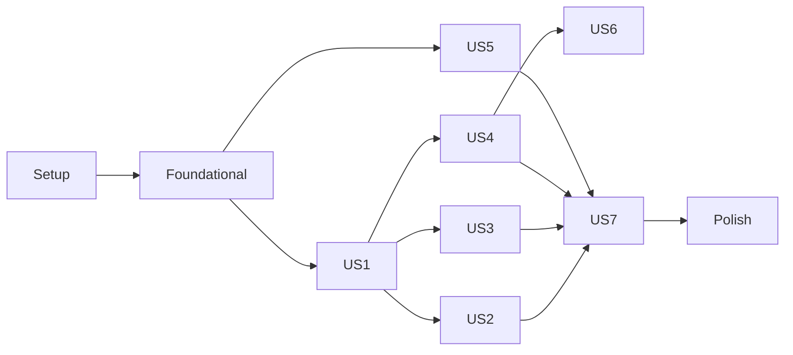

# Tasks: omai — Personal Coding-Agent Harness Manager

**Input**: Design documents from `specs/001-omai-harness-manager/`

**Prerequisites**: plan.md, spec.md, research.md, data-model.md, contracts/, quickstart.md

**Tests**: Included. Constitution V and Development Workflow require hermetic tests for registry and login behaviour. Tests are written before implementation within each story.

**Organization**: Grouped by user story (spec.md US1–US7) in priority order.

## Format: `[ID] [P?] [Story] Description`

- **[P]**: parallelizable (different files, no incomplete dependencies)
- **[Story]**: US1–US7 from spec.md

---

## Phase 1: Setup

- [X] T001 Replace scaffold `main.py` with `src/omai/` package (`__init__.py`, `__main__.py` calling `omai.cli:app`); delete `main.py`
- [X] T002 Update `pyproject.toml`: description, hatchling build backend, `src` layout, deps typer>=0.27, textual>=8.2, httpx>=0.28, tomlkit>=0.15, packaging>=26, platformdirs>=4.11; dev group pytest>=9.1, pytest-asyncio; `[project.scripts] omai = "omai.cli:app"`; package-data for `registry/*.toml` and `bundled_skills/**`; pytest marker `live` excluded by default (`addopts = "-m 'not live'"`)
- [X] T003 [P] Configure ruff (lint + format) in `pyproject.toml` `[tool.ruff]`
- [X] T004 [P] Add `.gitignore` entries for `.venv/`, `__pycache__/`, `.pytest_cache/`, `dist/`

---

## Phase 2: Foundational (blocks all stories)

- [X] T005 Implement `tests/conftest.py` fixture `fake_home`: temp dir set as `HOME`, `XDG_CONFIG_HOME`, `XDG_STATE_HOME`; `PATH` = temp `bin/` only plus `/usr/bin:/bin`; creates canary credential files (`~/.claude/.credentials.json`, `~/.codex/auth.json`, `~/.hermes/auth.json`, `~/.pi/agent/auth.json`) and installs a `sys.addaudithook` that fails the test if any canary path is `open`ed by the test process
- [X] T006 Implement `tests/fakes/fake_harness.py` + factory fixture `fake_bin(name, version_output, status_exit=0, stdout_lines=[], state_file=...)` writing an executable script into `fake_home/bin` (optionally under a channel-shaped path with a symlink) that appends `argv` as a JSON line to `fake_home/invocations.jsonl`, prints canned output, and supports status toggling via a state file (e.g. `login` flips status to 0)
- [X] T007 [P] Implement `tests/conftest.py` fixture `mock_http` returning an `httpx.MockTransport` keyed by URL for npm/github/pypi/url_text sources
- [X] T008 Implement `src/omai/runner.py`: `run(argv, timeout, capture=True) -> Result(code, stdout, stderr)`; `run_interactive(argv, on_line)` inheriting the TTY while scanning output lines (pty) for URLs; `~` expansion in argv; never uses shell unless argv[0] == "sh"
- [X] T009 [P] Implement `src/omai/platform.py`: `os_kind()` → linux|wsl|macos (WSL via `/proc/sys/kernel/osrelease` containing "microsoft"); `open_url(url)` using `cmd.exe /c start "" url` → `powershell.exe Start-Process` fallback (WSL), `open` (macOS), `xdg-open` (Linux); always prints the URL; `which_real(bin)` → (path, realpath); `runtime_version(name)` for node/bun/uv/python
- [X] T010 Write `tests/unit/test_registry.py`: loads packaged registry, asserts every entry validates (unique ids, regexes compile, `login.mode=command` ⇒ argv, ≥1 channel) and that invalid fixtures raise
- [X] T011 Implement `src/omai/registry/__init__.py`: dataclasses `HarnessDef`, `ChannelDef`, `VersionProbe`, `LatestSource`, `LoginSpec`, `AuthStatusSpec`, `SkillsDirSpec`, `Requirement` per data-model.md; `load_registry()` via `tomllib` + `importlib.resources`; validation errors raise `RegistryError`
- [X] T012 Author `src/omai/registry/harnesses.toml` entries for claude, codex, hermes, pi, omp, speckit, omai using research.md R1/R2 and contracts/registry.schema.md (channels with detect globs, install/uninstall argv, `runtime_bound_if = ["~/.nvm/**"]` on npm channels, pi `login.mode="manual"` with hint "Run `pi`, then /login openai-codex", hermes `config_patch` + `skills_dir.kind="external_dirs"`, claude `skills_dir.kind="symlink"` path `~/.claude/skills`, pi `requires node>=22.19`)
- [X] T013 [P] Write `tests/unit/test_config.py`: defaults written when missing; unknown harness id → `ConfigError` (exit 3); `grill-me` implies `grilling`; tomlkit round-trip preserves comments
- [X] T014 [P] Implement `src/omai/config.py`: `load_config(path)`, `write_default_config(path)` with defaults from contracts/config.schema.md, `ConfigError`, edit helpers (`set_harness_enabled`, `add_skill_source`, `remove_skill_source`) using tomlkit
- [X] T015 [P] Implement `src/omai/state.py`: `State` load/save (atomic write) at `$XDG_STATE_HOME/omai/state.json` with `installs`, `checks`, `auth`, `repos` per data-model.md
- [X] T016 Write `tests/unit/test_detect.py`: channel inference from realpaths (native claude versions dir, npm under nvm → `runtime_bound`, bun, standalone codex, git hermes); version regex parsing for each harness output sample in research/
- [X] T017 Implement `src/omai/detect.py`: `detect(harness) -> Install|None` (version via probe, channel via ordered globs on realpath, `runtime_bound` flag, runtime requirement warnings)
- [X] T018 [P] Implement `src/omai/report.py`: rich table renderer and JSON renderer for result/check/status rows; summary block with failures
- [X] T019 Implement `src/omai/cli.py` Typer app skeleton: global `--json`, `--config`, `-v`; exit-code constants (0/1/2/3); `ConfigError` → exit 3; subcommand stubs registered per contracts/cli.md filled by later tasks

**Checkpoint**: registry, config, state, detection, runner, fixtures ready.

---

## Phase 3: User Story 1 - One-shot machine setup (P1) 🎯 MVP

**Goal**: `omai up` converges installs, adopting existing ones, idempotently, continuing past failures.

**Independent Test**: fake HOME with claude present and others absent → `omai up --no-login` installs missing via fake install commands, leaves claude untouched; second run executes zero steps; forced failure in one install still runs others and exits 1.

- [X] T020 [P] [US1] Write `tests/integration/test_up.py`: adopt-existing (no install invocation for present harness), installs missing, idempotent second run ("nothing to do", exit 0, no new invocations), failure continues + summary + exit 1, never invokes `sudo` (assert no argv contains sudo)
- [X] T021 [P] [US1] Write `tests/unit/test_runtimes.py`: missing bun/uv → user-local installer argv chosen; node too old for pi → warning with remediation; system prereq (bubblewrap) → printed command, no execution
- [X] T022 [US1] Implement `src/omai/install.py`: `install(harness, channel)`, `ensure_runtimes(requirements)` (uv via `astral.sh/uv/install.sh`, bun via `bun.sh/install`), system-prereq hints
- [X] T023 [US1] Implement `src/omai/converge.py`: `plan(config, registry, state) -> list[Step]` (runtime → install → config_patch → skills → login ordering; skip satisfied), `execute(steps) -> Summary` continuing on failure; records installs in state
- [X] T024 [US1] Implement harness config patching in `src/omai/install.py` (`config_get`/`config_set`/`pending_patches`): apply registry `config_patches` (hermes `config set auth.adopt_external_logins false`), idempotent by probing current value via `hermes config get` first
- [X] T025 [US1] Wire `omai up [--no-login] [--only ID...]` and `omai install ID` in `src/omai/cli.py`; writes default config if missing
- [X] T026 [P] [US1] Write `bootstrap.sh`: install uv if absent (user-local), `uv tool install git+https://github.com/omar2535/oh-my-ai`, then `omai up`; `set -eu`, no sudo

**Checkpoint**: MVP — `omai up --no-login` works end-to-end.

---

## Phase 4: User Story 2 - Guided logins (P1)

**Goal**: status-first, serial native logins; pi manual hint; browser opening incl. WSL.

**Independent Test**: fake harnesses report logged-out; `omai login --all` invokes each native login exactly once, never concurrently, skips already-logged-in, pi login never invoked.

- [X] T027 [P] [US2] Write `tests/integration/test_login.py`: logged-in harness → no login argv; logged-out codex/omp/hermes/claude → one login each, invocation timestamps non-overlapping; pi → hint printed, no pi login argv; `--force` warns for codex; canary credential files untouched (audit hook); status re-probed after login
- [X] T028 [P] [US2] Write `tests/unit/test_platform.py`: WSL detection from fake osrelease; opener argv per OS (monkeypatched runner); URL extraction from mixed stdout/stderr lines incl. device-code output
- [X] T029 [US2] Implement `src/omai/auth.py`: `auth_status(harness) -> ok|missing|unknown|manual` via `exit_code`/`json_path`/`regex` parsers; `login(harness, force=False)` acquiring `fcntl` lock `$XDG_STATE_HOME/omai/login.lock`, running `runner.run_interactive`, opening first detected URL once, re-probing status; provider selection from config (`openai-codex` args for omp/hermes)
- [X] T030 [US2] Wire `omai login [ID...|--all] [--force]` and `omai status [--json]` in `src/omai/cli.py`; add login step execution to `converge.py` (skipped with `--no-login`)

---

## Phase 5: User Story 3 - See and apply updates (P1)

**Goal**: read-only `omai check`, native `omai update`, self-update.

**Independent Test**: mock latest sources; `omai check --json` lists correct `update_available`; tree hash of fake HOME (excluding omai state cache) unchanged; `omai update codex` invokes `codex update`.

- [X] T031 [P] [US3] Write `tests/unit/test_versions.py`: npm/github/pypi/url_text parsing incl. codex `rust-v` tag and hermes `v` prefix; `packaging` compare with non-PEP440 fallback; timeout → cached value + error; claude uses `latest` or `stable` URL per config
- [X] T032 [P] [US3] Write `tests/integration/test_check_update.py`: check read-only (hash fake HOME before/after excluding `$XDG_STATE_HOME/omai`); `--exit-code` → 1 when outdated, 0 when current, 2 when offline; `--json` shape matches contracts/cli.md; `omai update --all` invokes each registry `update` argv; runtime_bound warning present for nvm-channel codex
- [X] T033 [US3] Implement `src/omai/versions.py`: async `fetch_latest(source)` with httpx, 5 s timeout, parallel `gather`; cache read/write in state with TTL; `compare(installed, latest)`
- [X] T034 [US3] Implement `src/omai/update.py`: `update(ids|all)` running registry `update` argv, re-detect after; speckit uses `uv tool install --force specify-cli`; omai uses `uv tool upgrade omai`
- [X] T035 [US3] Wire `omai check [--json] [--exit-code] [--cached]` and `omai update [ID...|--all]` in `src/omai/cli.py`, including omai self row (installed via `importlib.metadata`, latest via GitHub tags)

---

## Phase 6: User Story 4 - Skills installed once, visible everywhere (P2)

**Goal**: pinned skill fetch into `~/.agents/skills`, Claude symlinks, Hermes external_dirs, lockfile, read-only drift.

**Independent Test**: `omai skills sync` with mocked tarball → `~/.agents/skills/{grill-me,grilling,grill-speckit}`, `~/.claude/skills/*` symlinks, hermes `config set` invoked for external_dirs; drift check reports changed sha without writes.

- [X] T036 [P] [US4] Write `tests/integration/test_skills.py`: sync installs grill-me+grilling together; claude symlinks resolve to canonical; existing non-symlink conflict in `~/.claude/skills` reported, not overwritten; each harness's discovery dirs (registry `skills_dir`) yield each skill exactly once; drift read-only; remove source → skill removed + lock updated
- [X] T037 [P] [US4] Author bundled skill `src/omai/bundled_skills/grill-speckit/SKILL.md` from contracts/grill-speckit.SKILL.md
- [X] T038 [US4] Implement `src/omai/skills.py`: tarball fetch at pinned sha (`codeload.github.com`), extract selected skill dirs, sha256 per skill, lock at `$XDG_CONFIG_HOME/omai/skills.lock.json`, bundled source copy, fan-out per `skills_dir` kind (`canonical` no-op, `symlink`, `external_dirs` via hermes config patch), `drift()` via GitHub commits API
- [X] T039 [US4] Wire `omai skills list|add REPO@REF --skill N|remove N|sync` in `src/omai/cli.py`; add skills step to `converge.py`; add skills drift rows to `omai check`

---

## Phase 7: User Story 5 - Per-repo spec-kit setup and tracking (P2)

**Goal**: `omai init` installs claude, codex, pi, omp integrations (default omp), tracks repo, refreshes on request.

**Independent Test**: fake `specify` records argv; `omai init /tmp/repo` produces expected init + integration install/use calls, repo in `omai repos list`; `omai update speckit --repos` calls `specify integration upgrade` per integration; missing repo flagged.

- [X] T040 [P] [US5] Write `tests/integration/test_repos.py`: init argv sequence per research.md R10 (no hermes); spec-kit < 1.0 → prompts update and aborts; already-initialized repo only adds missing integrations; Hermes trust hint printed; refresh skips + flags deleted repo
- [X] T041 [US5] Implement `src/omai/repos.py`: `init(path)`, `track/untrack`, `refresh_all()` using `specify integration status --json` to discover installed integrations
- [X] T042 [US5] Wire `omai init [PATH]`, `omai repos list|remove PATH`, and `--repos` flag on `omai update speckit` in `src/omai/cli.py`

---

## Phase 8: User Story 6 - Grill-to-spec workflow (P2)

**Goal**: bridge skill usable in every harness.

**Independent Test**: after `omai skills sync` + `omai init` in a scratch repo, the `grill-speckit` skill is discoverable by each harness; manual run creates `specs/<NNN>/grill.md` + spec.

- [X] T043 [US6] Add a `grill-speckit` default source to `write_default_config` in `src/omai/config.py` and assert in `tests/unit/test_config.py` that defaults include grill-me, grilling, grill-speckit
- [X] T044 [US6] Document the grill → speckit flow (commands per harness: `/speckit.specify` omp/pi, `/speckit-specify` claude, `$speckit-specify` codex) in `README.md`

---

## Phase 9: User Story 7 - Manage everything from the TUI (P3)

**Goal**: Textual dashboard with actions.

**Independent Test**: Textual `App.run_test()` pilot: dashboard renders cached rows before worker completes; pressing `u` on an outdated row invokes update; `x` uninstall keeps `~/.codex`.

- [X] T045 [P] [US7] Write `tests/integration/test_uninstall_migrate.py`: uninstall removes binary via channel argv, keeps config dir; `--purge` removes config dir after confirmation flag; `omai migrate codex --to standalone` installs new, verifies, removes old npm
- [X] T046 [US7] Implement `uninstall(harness, purge)` and `migrate(harness, to)` in `src/omai/install.py`; wire `omai uninstall ID [--purge]` and `omai migrate ID --to CHANNEL` in `src/omai/cli.py`
- [X] T047 [P] [US7] Write `tests/integration/test_tui.py` using Textual pilot: initial render from state cache without network; background worker fills latest column; key bindings i/u/U/l/L/x/s/r/c dispatch to service functions (monkeypatched)
- [X] T048 [US7] Implement `src/omai/tui/app.py`: `OmaiApp` with bindings per research.md R8, `@work(exclusive=True)` check worker honoring TTL, `App.suspend()` around logins
- [X] T049 [P] [US7] Implement `src/omai/tui/dashboard.py`: `DataTable` columns id, installed, latest, channel, auth, skills, warnings
- [X] T050 [P] [US7] Implement `src/omai/tui/skills_screen.py`: list sources/lock entries, add/remove source, sync
- [X] T051 [P] [US7] Implement `src/omai/tui/repos_screen.py`: tracked repos with health, init current dir, refresh, remove
- [X] T052 [US7] Wire `omai` (no args) and `omai tui` to launch `OmaiApp` in `src/omai/cli.py`

---

## Phase 10: Polish & Cross-Cutting

- [X] T053 [P] Write `tests/live/test_live_smoke.py` (`@pytest.mark.live`): real version probes and latest sources; verify hermes/omp auth-status commands and `hermes config set` list-append (research.md R1/R5 verify items); record findings back into `src/omai/registry/harnesses.toml`
- [X] T054 [P] Write `README.md` install/usage section (bootstrap, `omai up`, check/update, login, skills, init) consistent with contracts/cli.md
- [X] T055 Run quickstart.md local manual scenarios on this machine and fix discrepancies
- [X] T056 Run `uv run ruff check && uv run ruff format --check && uv run pytest` and resolve failures

---

## Dependencies & Execution Order

- Setup (T001–T004) → Foundational (T005–T019) → stories.
- US1 (T020–T026) is MVP; US2, US3 depend only on Foundational but both extend `converge.py`/`cli.py`, so run after US1.
- US4 depends on Foundational + `config_patch.py` (T024). US5 independent of US4. US6 depends on US4 (T037). US7 depends on US1–US5 services.
- Within stories: tests → implementation → CLI wiring.

## Parallel Examples

- Foundational: T007, T009, T013, T014, T015, T018 in parallel after T005/T006.
- US1: T020, T021, T026 together; then T022 → T023 → T024 → T025.
- US3: T031 + T032 together; T033 and T034 in parallel (different files); then T035.
- US4: T036 + T037 together.
- US7: T047, T049, T050, T051 in parallel after T045/T046.

## Implementation Strategy

1. MVP: Phases 1–3 → `omai up --no-login` adopts/installs all five harnesses idempotently. Validate with quickstart.
2. Add US2 (logins) and US3 (check/update) → covers all P1 stories; release to own machine.
3. Add US4–US6 (skills, repos, bridge) → full grill → spec-kit workflow.
4. Add US7 TUI, then Polish (live smoke resolves the unverified registry commands).
